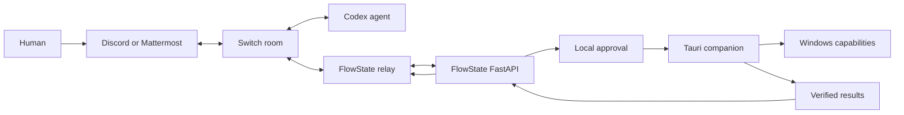

# FlowState OS

Team chat is where work gets discussed. Your desktop is where you open the project, find the right tabs, and put everything back in place. FlowState OS connects those two parts of the job.

It takes contributions from a Switch room and lets you assemble a workspace plan. You review the saved version, approve its actions on your Windows machine, and choose whether to send the result counts back to the room. It also saves window arrangements so you can restore matching windows later.

Built for the WeMakeDevs Flip the Switch hackathon with React, FastAPI, Tauri, and Switch.

## Architecture

## What to look for in the demo

The judging criteria are Switch usage (30%), technical execution (25%), creativity and impact (25%), and presentation (20%). Here is the evidence this project offers for each:

| Criterion | What FlowState does | Evidence and limits |
| --- | --- | --- |
| Use of Switch | Receives team contributions through a dedicated relay and publishes approved results to the original room. | Live Mattermost room coverage was verified. Without Switch, this collaboration path stops; local workspace tools still work. |
| Technical execution | React UI, FastAPI persistence, and a Tauri Windows companion with approval gates. | Reproduction commands below; web build and 17 API tests pass. Discord live setup and a full interactive demo remain pending. |
| Creativity and impact | Takes a shared workspace plan from team chat to each person's locally approved setup, with saved window arrangements. | Intended to reduce repeated setup during shared coding or research sessions; no measured productivity claim. |
| Presentation | Shows where messages, approvals, local actions, and results belong. | The architecture and recording script explain the boundaries. The generated captioned UI tour is not proof of an end-to-end agent run. |

Motion includes page slides, viewport fade-ins, and button feedback, with reduced-motion support. The reveal component is adapted from Klyv UI through 21st.dev; see [third-party notices](THIRD_PARTY_NOTICES.md).

### Data flow



Switch handles the rooms and routes messages between people and agents. The separate FlowState relay brings room contributions into the app. FlowState handles saved plans and local approval. Reading a chat message does not grant permission to control your desktop.

## Hackathon status

The Operations page lets you create specialist profiles, assign tasks, auto-route by explicit skill and current queue size, and inspect assignment reasons. Assignments persist in this browser. After connecting in Settings, **Run assigned agent** submits an authenticated Codex job to the API host. Jobs persist in the database, run with a read-only sandbox and a 180-second timeout, and expose their actual answer or failure. Two jobs can run concurrently. A live task returned its expected answer on November 7. Marking an assignment reviewed remains a human planning action, separate from execution. This runner is not yet integrated with Switch's agent controller or deployed to a remote server.

The interface includes TempVault-inspired warm dark and cream/violet light themes, an animated theme transition, task-entry animations, and scroll reveals. Reduced-motion preferences disable movement.

On November 7, the relay connected to Switch Core 0.31.0 and a real Mattermost room. Authentication, discovery of 57 operations, and WebSocket room coverage passed. A separate Codex identity is registered; a complete conversation with its running agent still needs to be demonstrated.

Mattermost and Discord can be used in the same build through separate Switch rooms. The inbox can filter by room, and plans publish results back to their own room. Mattermost is connected on the development machine. Discord support is implemented and covered by adapter tests, but its bot bridge has not been configured or tested live here.

The web production build and 17 backend tests pass. Earlier checks also passed 3 frontend and 10 native tests; one optional launch test is excluded because Windows policy blocked its fixture. The full chat-to-desktop demo and recording are still pending. See the [submission brief](docs/hackathon-submission.md), [demo runbook](docs/demo.md), and [Switch setup](docs/switch-setup.md).

## Run on Windows

Requirements: Node 22+, pnpm 11+, uv, Python 3.12+, Rust and MSVC build tools, Windows WebView2 for the desktop shell.

```powershell
pnpm install
cd services/api
uv sync --python 3.12 --group dev
cd ../..
./scripts/start-api.ps1
```

The API script loads the ignored root `.env` when present, generates an ephemeral session token when none is set, applies migrations, and binds to loopback. Keep that terminal open. In another terminal:

```powershell
pnpm dev
# Or run the desktop shell (do not also run the web dev server):
pnpm --filter @flowstate/desktop dev
```

Open http://127.0.0.1:5173 for the web portal. Enter the API token in Settings. Create a workspace, add URLs, save, and reopen it from Resume. In the desktop shell, Local windows → Allow window discovery reads visible windows every five seconds until stopped. Window titles are not uploaded to the API.

SQLite is the local development default. For PostgreSQL, set `POSTGRES_PASSWORD`, run `docker compose up -d`, and set `FLOWSTATE_DATABASE_URL` to a `postgresql+psycopg://` connection URL before migrations. Docker Desktop and Linux containers were verified on the demo host; Switch's local Mattermost service is running in Docker.

## Verify

```powershell
pnpm build
pnpm test
cd services/api
.venv/Scripts/python.exe -m pytest -q
.venv/Scripts/ruff.exe check app tests migrations
cd ../../apps/desktop/src-tauri
cargo test
cargo build
```

For the real browser/API workflow, start the API with `FLOWSTATE_API_TOKEN` set in your environment. In a terminal with the same token:

```powershell
pnpm --filter @flowstate/web exec playwright install chromium
pnpm --filter @flowstate/web exec playwright test
```

The test creates a workspace through the UI, edits resources, selects a graph node, revisits the saved configuration, and deletes the test workspace. Screenshots go to `apps/web/test-results`.

## Current limitations

- Intent text creates a named draft; there is no connected model or intent planner.
- The resource graph represents configuration, not live OS window positions.
- Native discovery reads titles, process IDs, process start time, handles, bounds, minimized/maximized state, and monitor work areas. Executable paths for discovered windows and native event subscriptions are not implemented. Trusted applications are selected with a native picker, stored with SHA-256 hashes, and rechecked before an approved launch. An application update requires re-registration.
- Time Machine captures selected windows into local SQLite. Preview and restore support normal windows whose handle, process ID, process start time, and title still match. Native approval is required, and a pre-restore snapshot enables a separately approved rollback attempt. Bounds are verified after each operation. Closed, renamed, elevated, inaccessible, minimized, and maximized windows are not restored. Version 2 snapshots use per-monitor DPI coordinates and record monitor work areas; incompatible display geometry and legacy snapshots are refused. Mixed-DPI hardware changes still need interactive validation.
- Collaboration receives addressed Switch messages from the live configured room, associates contributions with portable drafts, enforces revision-bound decisions, and can explicitly publish an approved plan. A failed publication has an unknown outcome and cannot automatically retry. The two-human message/publication walkthrough still requires interactive demo participants.
- Approved shared plans can request up to 20 native app-launch, URL-open, or authorized VS Code project-folder actions. A native dialog confirms exact actions; results persist locally and stream to the UI. Execution IDs prevent replay, cancellation stops remaining actions, and interrupted work is never automatically retried. Browser acceptance is not a verified tab load. Users can explicitly publish result counts to the room without local paths or window titles. Project cloning and automatic matching of newly opened windows remain pending.
- Local windows offers focus, split, coding, research, presentation, and triple layouts on a selected monitor, with preview, native confirmation, rollback capture, and bounds verification. Select normal windows manually after launching applications.
- Activity shows local plan execution results. External OAuth connectors, browser extension, and FlowBar are not implemented.
- Authentication is a single-device development token held in UI memory. Multi-user identity, OS credential storage, granular permissions, audit persistence, and production deployment are pending.

See [security notes](docs/security.md) for the current trust boundaries.
