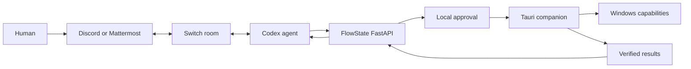

# FlowState OS

Your workspace, shaped by your intent.

Implementation is in progress. Workspace CRUD, the web portal, Windows discovery, snapshots and bounded restore, a Switch connection/inbox adapter, revision-bound shared-plan approval, trusted application launches, and locally approved URL execution are implemented. The Switch adapter is contract-tested but not yet live-verified. See [the completion queue](docs/work-queue.md) and [Switch setup](docs/switch-setup.md).

## Architecture



Switch owns rooms, message routing, and human-agent collaboration. FlowState owns portable manifests, workspace state, local approval, and constrained OS execution. Remote messages must never invoke OS actions directly.

## Development status

This is a runnable foundation, not yet the complete hackathon MVP.

## Run on Windows

Requirements: Node 22+, pnpm 11+, uv, Python 3.12+, Rust and MSVC build tools, Windows WebView2 for the desktop shell.

```powershell
pnpm install
cd services/api
uv sync --python 3.12 --group dev
cd ../..
./scripts/start-api.ps1
```

The API script generates an ephemeral session token when none is set, applies migrations, and binds to loopback. Keep that terminal open. In another terminal:

```powershell
pnpm dev
# Or run the desktop shell (do not also run the web dev server):
pnpm --filter @flowstate/desktop dev
```

Open http://127.0.0.1:5173 for the web portal. Enter the API token in Settings. Create a workspace, add URLs, save, and reopen it from Resume. In the desktop shell, Local windows → Allow window discovery reads visible windows every five seconds until stopped. Window titles are not uploaded to the API.

SQLite is the local development default. For PostgreSQL, set `POSTGRES_PASSWORD`, run `docker compose up -d`, and set `FLOWSTATE_DATABASE_URL` to a `postgresql+psycopg://` connection URL before migrations. PostgreSQL/Compose has not been run on this host because Docker is unavailable.

## Verify

```powershell
pnpm build
pnpm test
cd services/api
.venv/Scripts/python.exe -m pytest -q
.venv/Scripts/ruff.exe check app tests migrations
cd ../../apps/desktop/src-tauri
cargo test
cargo build
```

For the real browser/API workflow, start the API with `FLOWSTATE_API_TOKEN` set in your environment. In a terminal with the same token:

```powershell
pnpm --filter @flowstate/web exec playwright install chromium
pnpm --filter @flowstate/web exec playwright test
```

The test creates a workspace through the UI, edits resources, selects a graph node, revisits the saved configuration, and deletes the test workspace. Screenshots go to `apps/web/test-results`.

## Current limitations

- Intent text creates a named draft; there is no connected model or intent planner.
- The resource graph represents configuration, not live OS window positions.
- Native discovery reads titles, process IDs, process start time, handles, bounds, minimized/maximized state, and monitor work areas. Executable paths for discovered windows and native event subscriptions are not implemented. Trusted applications are selected with a native picker, stored with SHA-256 hashes, and rechecked before an approved launch. An application update requires re-registration.
- Time Machine captures selected windows into local SQLite. Preview and restore support normal windows whose handle, process ID, process start time, and title still match. Native approval is required, and a pre-restore snapshot enables a separately approved rollback attempt. Bounds are verified after each operation. Closed, renamed, elevated, inaccessible, minimized, and maximized windows are not restored. Version 2 snapshots use per-monitor DPI coordinates and record monitor work areas; incompatible display geometry and legacy snapshots are refused. Mixed-DPI hardware changes still need interactive validation.
- Collaboration receives addressed Switch messages, associates contributions with portable drafts, enforces revision-bound decisions, and can explicitly publish an approved plan to its configured room. A failed publication has an unknown outcome and cannot automatically retry. Live integration is pending your server credentials and room.
- Approved shared plans can request up to 20 native app-launch, URL-open, or authorized VS Code project-folder actions. A native dialog confirms exact actions; results persist locally and stream to the UI. Execution IDs prevent replay, cancellation stops remaining actions, and interrupted work is never automatically retried. Browser acceptance is not a verified tab load. Users can explicitly publish result counts to the room without local paths or window titles. Project cloning and automatic matching of newly opened windows remain pending.
- Local windows offers focus, split, coding, research, presentation, and triple layouts on a selected monitor, with preview, native confirmation, rollback capture, and bounds verification. Select normal windows manually after launching applications.
- Activity shows local plan execution results. External OAuth connectors, browser extension, and FlowBar are not implemented.
- Authentication is a single-device development token held in UI memory. Multi-user identity, OS credential storage, granular permissions, audit persistence, and production deployment are pending.
- Tailwind, shadcn/Radix, and Motion are not yet integrated; styling currently uses shared CSS tokens. The UI follows the supplied palette and the unslop craft guidance.

See [security notes](docs/security.md) for the current trust boundaries.
